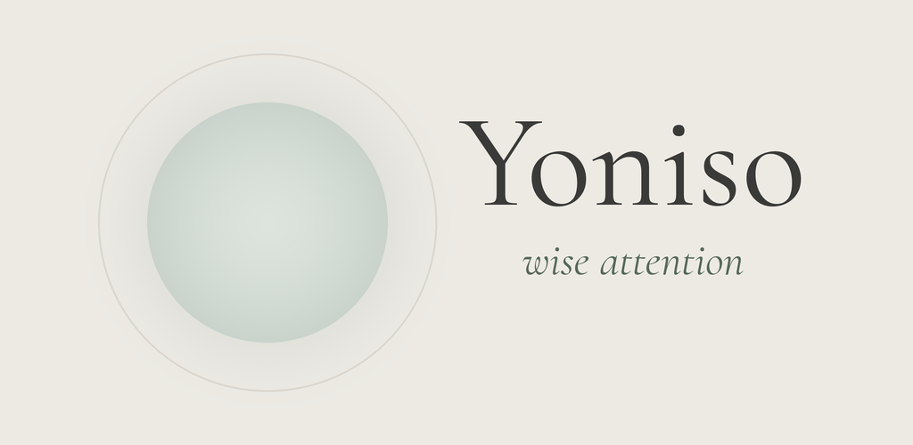
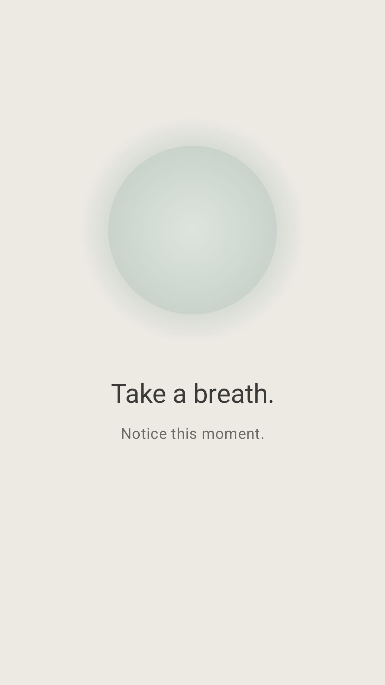
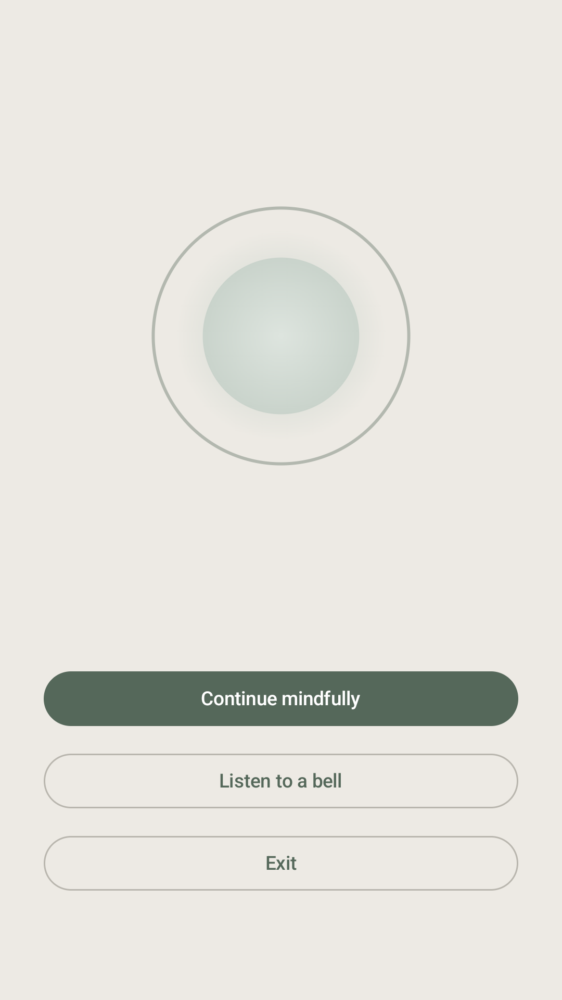
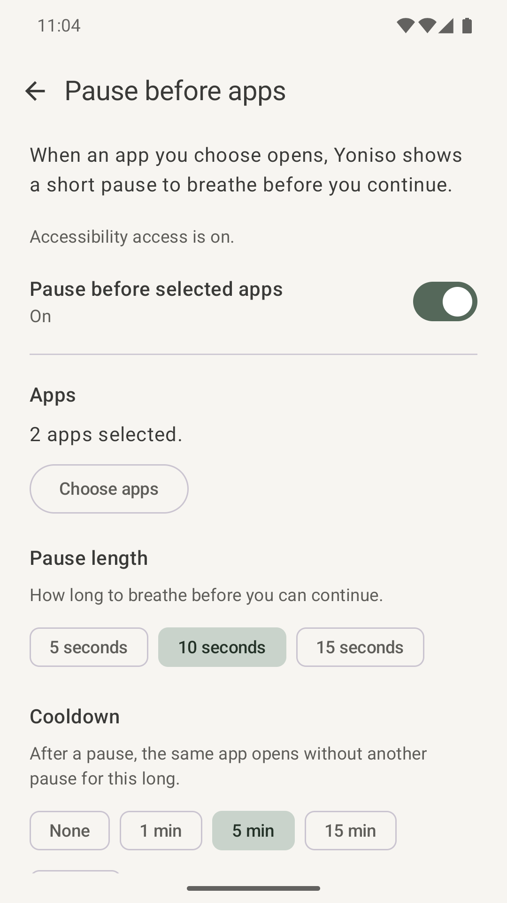
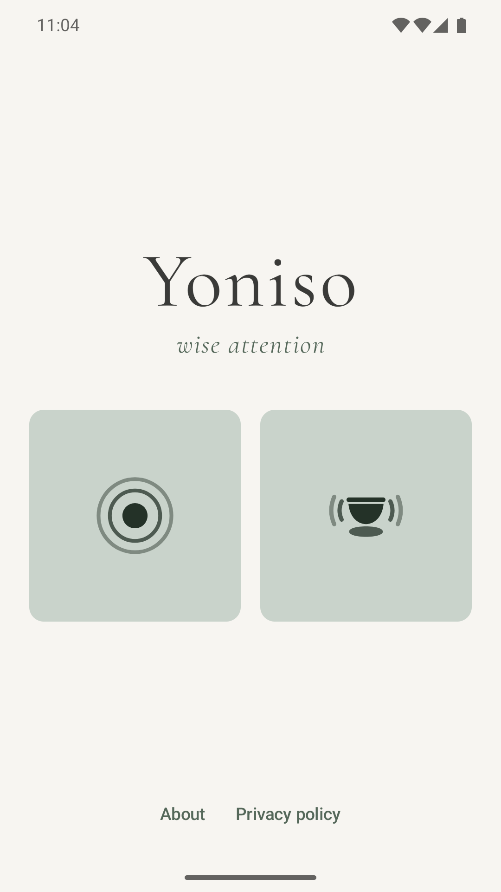
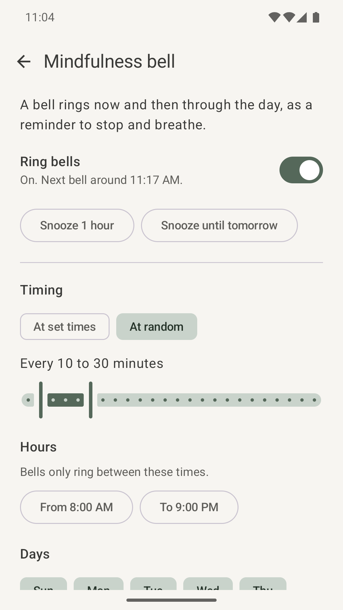
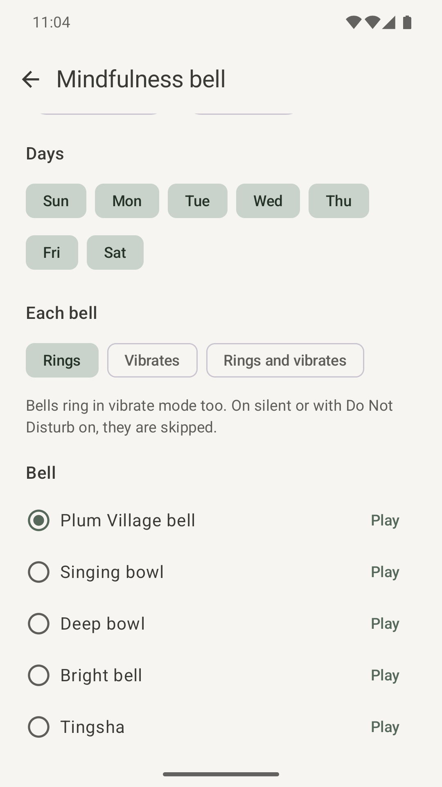

# Yoniso



An Android app for wise attention (*yoniso manasikāra*). It adds a short breathing pause before the apps you choose, and rings a mindfulness bell through the day. Everything happens on the phone: Yoniso has no internet access and collects nothing. See [prd.md](prd.md) for the product description.

**Status:** version 0.2 is in closed testing on Google Play. Both features are built ([docs/plan.md](docs/plan.md), [docs/bells-plan.md](docs/bells-plan.md)).

**Walkthrough:** [a two-minute video](https://www.youtube.com/shorts/wgY-dZ_5uK8) of the first launch, the accessibility disclosure, turning access on, and pauses with Continue and Exit. It was recorded for Play's accessibility declaration.

## Features

**Pause before apps.** When an app you choose opens, Yoniso covers it with a breathing circle for 5, 10 or 15 seconds. Then you choose: continue mindfully, listen to a bell, or exit to the home screen. A cooldown stops the same app pausing again straight away.

<p>
  
  
  
</p>

**Mindfulness bell.** A bell rings at set times or at random within the hours and days you choose, as a reminder to stop and breathe. Pick one of seven bells or add your own, and choose whether it rings, vibrates or both. Snooze it for an hour or until tomorrow, and turn it on or off from a Quick Settings tile.

<p>
  
  
  
</p>

The pause needs Android's accessibility access, used only to see which app comes to the front. Yoniso never reads what is on the screen. See the [privacy policy](PRIVACY.md).

## Build and run

Requirements: JDK 17+, an Android SDK with the `platforms;android-37.2` platform installed (to compile; the app targets API 37), and a device or emulator running Android 8.0 (API 26) or newer.

```sh
./gradlew installDebug
# Enable the accessibility service (or use Settings > Accessibility > Yoniso):
adb shell settings put secure enabled_accessibility_services \
  app.yoniso/app.yoniso.service.YonisoAccessibilityService
adb logcat -s Yoniso
```

## How it works

- `YonisoAccessibilityService` listens only for `TYPE_WINDOW_STATE_CHANGED` and reads only the event's package name. It never reads window content (`canRetrieveWindowContent="false"`).
- The overlay is a `TYPE_ACCESSIBILITY_OVERLAY` window holding a `ComposeView`, so it does not need the "display over other apps" permission.
- A pause is triggered only when the foreground package *changes*. Later events from the same app count as duplicates, so tapping Continue does not retrigger the pause.
- The overlay is removed when another app comes to the front, the screen turns off, a phone call starts ringing, or the service is disabled or destroyed.
- Decisions live in a pure state machine (`core/PauseMachine`) with unit tests (`./gradlew testDebugUnitTest`).

### Mindfulness bell

- Only the next bell is ever set, as one `AlarmManager` alarm. When it fires, `BellReceiver` sets the one after, then decides whether to ring. The times come from a pure, unit-tested `core/BellSchedule` (set times on the clock, or random gaps, within active hours and days, with snooze and DST handled).
- The alarm is exact when the user allows "Alarms & reminders" (`SCHEDULE_EXACT_ALARM`), otherwise inexact. It is set again after a reboot, an app update, and a time or time zone change.
- The bell plays from `BellService`, a short foreground service (`shortService` on Android 14+, no type before), on the alarm stream with audio focus that lets music duck. Vibration plays from the receiver.
- A bell is skipped on silent, in Do Not Disturb, during a call and while a pause is showing. While media plays it vibrates only, rings or is skipped, as chosen. It rings in vibrate mode.
- Custom bells are copied into app storage (`filesDir/bells`) through the system file picker, so no storage permission is needed.
- A Quick Settings tile ("Bell") turns bells on and off and shows the next bell or the snooze.
- Debug builds have `BellDebugReceiver` to drive bells over adb; see its doc comment.

## Platform limitations and assumptions

- **Sideloaded apps (Android 13+):** Android blocks enabling accessibility for apps not installed from a store until the user allows it under *App info > ⋮ > Allow restricted settings*. The settings screen explains this.
- **OEM battery managers:** Some manufacturers kill or freeze accessibility services in the background. Users may need to exempt Yoniso from battery optimisation.
- **Lock screen:** The overlay never appears over the lock screen. It is dismissed when the screen turns off. Unlocking back into a selected app pauses again only if its cooldown has expired, and never right after the user chose Continue.
- **The app is briefly visible:** Android reports the new window after it is drawn, so the selected app shows for a moment before the pause covers it.
- **Status bar:** The pause covers the whole screen, status bar included, so the notification shade can't be pulled down while it shows. Home and Recents always work, and leave the pause.
- **Phone calls:** A ringing call dismisses the pause, and no pause starts during a call. On Android 12+ this uses the audio mode (carrier calls and most VoIP apps). On Android 8–11 it uses the call state, which covers carrier calls only, because VoIP calls don't change it.
- **Audio:** During a pause, Yoniso takes audio focus and mutes media, because many games ignore audio focus. Background music also pauses or mutes for the length of the pause. The media volume is restored afterwards, even if Yoniso was killed mid-pause.
- **Popups:** A window that doesn't fill the screen (e.g. a Play Store or Play Games prompt) from an unselected app is not treated as leaving the app. A full-screen window from another package (e.g. a share sheet or the permission controller) is, and the cooldown stops this from causing repeated pauses.
- **Reduced motion:** Android has no dedicated setting, so Yoniso treats *Remove animations* (animator duration scale 0) as reduced motion: the circle is still and nothing fades.
- **Bells without "Alarms & reminders":** Android may deliver an inexact alarm late, and in Doze about once every 9 minutes at most. A late bell is skipped rather than rung late. Android only lets the bell's service start from an exact alarm, or while the accessibility service is on, so with neither, bells only vibrate.
- **Bell loudness:** bells follow the alarm volume (scaled by the bell volume slider), because the notification stream is muted in vibrate mode.
- **Vibration:** Android's own vibration settings (e.g. *Notification vibration* turned off; bells vibrate as notifications) can silence a bell's vibration. The strength and shape controls only show on phones with amplitude control.
- **Battery managers and bells:** some manufacturers delay or drop alarms for apps in the background. Exempting Yoniso from battery optimisation helps.
- **Another pause app:** Apps that also put up an overlay when an app opens (e.g. one sec) may stack their overlay with Yoniso's if both watch the same app.

## Google Play

Yoniso is not an accessibility tool, so it must not set `isAccessibilityTool`. Play's AccessibilityService policy then requires:

- **In-app prominent disclosure and consent:** shown on the "Pause before apps" page while access is off. The first-launch intro only explains the two features and doesn't ask for access, so the disclosure always comes right before the request. It says what is accessed, how it is used, and that nothing is shared, then asks for an explicit "Agree and open settings". "Not now" declines. Leaving the screen is never treated as consent. The service's description string does not count as the disclosure.
- **Accessibility API declaration (Console):** the reason for use is app functionality. Answer **No** to collecting or sharing personal and sensitive data through accessibility. The declaration's video is the [walkthrough](https://www.youtube.com/shorts/wgY-dZ_5uK8) (unlisted, recorded 2026-11-20 on the emulator, captioned). Re-record it if the disclosure or the way access is requested changes.
- **Privacy policy:** [PRIVACY.md](PRIVACY.md), published at https://github.com/mstyles/yoniso/blob/main/PRIVACY.md and linked from the bottom of the home screen. The same URL is in the Play Console.
- **Data safety form (Console):** Play counts data as collected only if it is "transmitted off a user's device", and Yoniso processes everything on the device.
  - "Does your app collect or share any of the required user data types?" **No.** The encryption and deletion questions are then skipped.
  - Data types: none, not even "Installed apps" or "App interactions" (on-device only). The listing then shows "No data collected" and "No data shared with third parties".
  - Target audience: not children, so the Families policy doesn't apply.
  - Revisit this form, the declaration and PRIVACY.md if Yoniso ever gains the `INTERNET` permission, an analytics or crash-reporting SDK, or a cloud backup of its data.
- **Foreground service:** `BellService` uses `shortService` on Android 14+ and no type before that. It deliberately doesn't use `mediaPlayback`, whose declaration video must show playback the user starts, which an alarm-started bell isn't. See "Phase 10: as built" in [docs/bells-plan.md](docs/bells-plan.md).
- **Exact alarms:** Yoniso uses `SCHEDULE_EXACT_ALARM`, which the user grants, and not `USE_EXACT_ALARM`, which Play restricts to alarm-clock and calendar apps.
- **targetSdk:** 37 (Android 17). Play currently requires 36 or higher. Android 17's background-audio hardening blocks audio focus and volume changes from background apps. Tested on a Pixel 8 (Android 17) targeting 37: while the pause shows, focus is granted and media is muted, then both are released, with no `AudioHardening` entries for Yoniso. Watch for this if the overlay or audio code changes.

### Releasing

1. Raise `versionCode` (and `versionName`) in `app/build.gradle.kts`. Play rejects a bundle whose version code it has seen.
2. `./gradlew :app:bundleRelease`. It is signed with the upload key when `YONISO_UPLOAD_STORE_FILE`, `YONISO_UPLOAD_STORE_PASSWORD`, `YONISO_UPLOAD_KEY_ALIAS` and `YONISO_UPLOAD_KEY_PASSWORD` are set in `~/.gradle/gradle.properties` (the key stays out of the repo). Without them the bundle is unsigned.
3. Upload `app/build/outputs/bundle/release/app-release.aab` to a new release on the track in the Play Console.

### Closed testing

Testers are a Google Group added on the closed testing track's **Testers** tab. To join, a tester accepts the group invitation, then opens the opt-in link (https://play.google.com/apps/testing/app.yoniso) with the same Google account they use for the Play Store and taps **Become a tester**, then installs Yoniso from Play. A new personal developer account needs at least 12 testers opted in for 14 days in a row before it can apply for production access; the Console's dashboard shows the progress.

Sources: Play Console Help on [AccessibilityService API use](https://support.google.com/googleplay/android-developer/answer/10964491), [best practices for prominent disclosure](https://support.google.com/googleplay/android-developer/answer/11150561), the [User Data policy](https://support.google.com/googleplay/android-developer/answer/10144311), and [Data safety](https://support.google.com/googleplay/android-developer/answer/10787469).

## Sounds

- **Plum Village bell** (`res/raw/bell.mp3`): a single strike trimmed from the Plum Village app's big bell, used with Plum Village's permission.
- The other bells are from [Freesound](https://freesound.org), under [CC0 1.0](https://creativecommons.org/publicdomain/zero/1.0/). Each was trimmed to one strike, faded out and normalised to about −20.5 LUFS, from Freesound's high-quality preview:

| Bell | File | Source | By |
|---|---|---|---|
| Singing bowl | `bell_singing_bowl.mp3` | [240934](https://freesound.org/people/the_very_Real_Horst/sounds/240934/) | the_very_Real_Horst |
| Deep bowl | `bell_deep_bowl.mp3` | [421829](https://freesound.org/people/dersinnsspace/sounds/421829/) | dersinnsspace |
| Bright bell | `bell_bright_bell.mp3` | [346328](https://freesound.org/people/steaq/sounds/346328/) | steaq |
| Tingsha | `bell_tingsha.mp3` | [435074](https://freesound.org/people/steffcaffrey/sounds/435074/) | steffcaffrey |
| Harmony bell | `bell_harmony_bell.mp3` | [400605](https://freesound.org/people/newagesoup/sounds/400605/) | newagesoup |
| Temple bell | `bell_temple_bell.mp3` | [668647](https://freesound.org/people/tec_studio/sounds/668647/) | tec_studio |

## Font

The "Yoniso" wordmark on the home screen is set in [Cormorant Garamond](https://github.com/CatharsisFonts/Cormorant) (Copyright 2015 the Cormorant Project Authors), under the [SIL Open Font License 1.1](licenses/Cormorant-OFL.txt). `res/font/yoniso_wordmark*.ttf` are cut down from Google Fonts' variable files to weight 400 and only the letters of "Yoniso" and "wise attention" (with fonttools: `varLib.instancer`, then `pyftsubset --text=... --name-IDs='*'`, which keeps the licence in the font), about 3 KB each. Use them for nothing else, or cut them again with the letters needed.

## License

[MIT](LICENSE)
